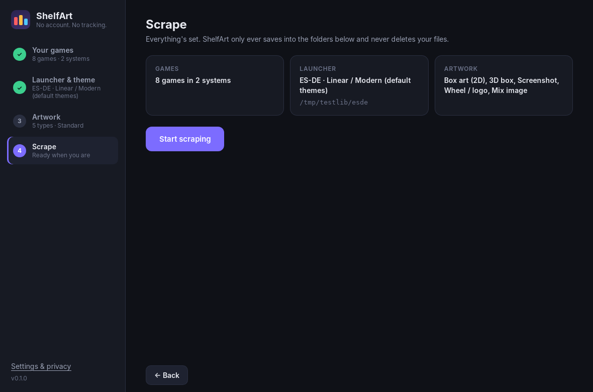

<p align="center">
  
</p>

<h1 align="center">ShelfArt</h1>

<p align="center">
  <b>Artwork for your emulated games — no account, no tracking.</b><br>
  Box art, 3D boxes, screenshots, title screens, logos, mix images, videos and manuals,<br>
  saved exactly where Pegasus, ES-DE, EmulationStation, RetroArch or LaunchBox expect them.
</p>

<p align="center">
  <a href="../../releases/latest"></a>
  <a href="../../actions/workflows/ci.yml"></a>
  
  
</p>

---

ShelfArt is a free, open-source alternative to account-based scrapers. Point it at your ROM folder, pick your launcher and theme style, press **Start**. That's it.



## Why ShelfArt

| | Typical scrapers | ShelfArt |
|---|---|---|
| Account | Required (email + password) | **None** |
| Tracking | Every request tied to your username | **Anonymous file downloads only** |
| Daily limits | Yes, by account level | **No limits** on the free collection |
| Renamed / odd file names | Often missed | **Identified by contents** (checksums & disc serials) |
| 3D boxes when none exist | — | **Rendered on your PC** from the cover |

## Features

- **Recognises games by their contents.** Cartridge games are matched by checksum against No-Intro; disc games (PS1, PS2, PSP, GameCube, Wii) by the serial number read from inside the image (Redump). `my crash backup.iso` still becomes *Crash Bandicoot (USA)*.
- **Every common art type:** box art, 3D boxes, back covers, cartridges/discs, screenshots, title screens, wheels/logos, fan art, mix images, video snaps and PDF manuals.
- **Made for your launcher:**

  | Launcher | Where art goes |
  |---|---|
  | Pegasus | `<system>/media/<game>/boxFront.png`, `screenshot.png`, `logo.png`, `video.mp4`… |
  | ES-DE | `downloaded_media/<system>/covers`, `3dboxes`, `screenshots`, `marquees`, `miximages`, `videos`, `manuals`… |
  | EmulationStation (Batocera, RetroPie, Recalbox, Knulli, ArkOS) | `<system>/images` + `gamelist.xml` (original backed up) |
  | RetroArch | `thumbnails/<system>/Named_Boxarts`, `Named_Snaps`, `Named_Titles`, `Named_Logos` (+ playlists) |
  | LaunchBox / Big Box | `Images/<platform>/Box - Front`, `Box - 3D`, `Clear Logo`…, `Videos`, `Manuals` |
  | Anything else | Plain folders per system and type |

- **Theme presets** pre-select what your style of theme shows (showcase, cover grid, 3D shelves, mix image…).
- **Sharp at any size.** Pixel-art screenshots are scaled crisply; box art is enlarged smoothly with light sharpening. Optional AI upscaling with [Real-ESRGAN](https://github.com/xinntao/Real-ESRGAN) if you have it installed.
- **Region preference**, skip-existing or overwrite, compact → 4K size presets.
- **75+ systems** — Nintendo, Sega, Sony, NEC, SNK, Atari, Commodore, MSX, arcade and more.
- **Command-line version** (`shelfart-cli`) for scripts, servers and handheld PCs.

## Download

Grab the installer for your system from **[Releases](../../releases/latest)**:

| System | File |
|---|---|
| Windows 10 / 11 | `ShelfArt_x.y.z_x64-setup.exe` (or `.msi`) |
| macOS (Apple Silicon & Intel) | `ShelfArt_x.y.z_universal.dmg` |
| Linux | `.AppImage`, `.deb` or `.rpm` |

> Builds are not code-signed yet. Windows SmartScreen may say "unknown publisher" — click **More info → Run anyway**. On macOS, right-click the app → **Open** the first time.

## Where the artwork comes from

| Art | Source | Account? |
|---|---|---|
| Box art, screenshots, title screens, logos | [libretro-thumbnails](https://github.com/libretro-thumbnails) — the free collection RetroArch uses | No |
| Game identification | [libretro-database](https://github.com/libretro/libretro-database) (No-Intro & Redump data) | No |
| Mix images, fallback 3D boxes | Made by ShelfArt on your computer | No |
| 3D boxes, videos, manuals, back covers, cartridges, fan art | [ScreenScraper](https://www.screenscraper.fr) in guest mode (ShelfArt's own developer registration) | No — optional login only for extra speed |

If one source is unreachable ShelfArt tries the other mirror, and everything already downloaded is kept in a local cache.

## Privacy & safety

- **No account, no telemetry, no analytics.**
- **Allow-listed connections only:** GitHub, libretro and screenscraper.fr over HTTPS. Redirects anywhere else are refused.
- **Clean files:** every downloaded image is fully decoded and re-saved as a fresh PNG; videos and manuals must be real MP4/PDF files; all downloads are size-capped.
- **Your files are safe:** ShelfArt never deletes or modifies your games, never writes outside the folders you choose, and backs up `gamelist.xml` before changing it.
- An optional ScreenScraper login is kept in memory for the session only — never saved to disk.

See [SECURITY.md](SECURITY.md) to report a vulnerability.

## Roadmap — one-click setup

ShelfArt is growing into a one-click setup tool for emulation handhelds (AYN Odin, Retroid Pocket…): pick a folder of your own games, press Start, and get a ready-to-copy `ROMs` folder.

- [x] Artwork scraper with launcher & theme layouts
- [x] Game identification by checksum and disc serial
- [x] Verification of Sony's official PS3 system software file
- [ ] Import & sort any folder layout into `ROMs/<console>`, with free-space check
- [ ] Compress disc games (PS1/PS2 → CHD, GameCube/Wii → RVZ) with verification before and after — originals never touched
- [ ] PS1/PS2 BIOS from your own copy of the official PS3 update (see below)
- [ ] Pegasus `metadata.pegasus.txt` with current launch lines and an on-device checklist

Third-party tools (chdman, DolphinTool, RPCS3) will be downloaded from their official sites when needed — they are never bundled. **ShelfArt never includes or downloads games, BIOS files or firmware.**

### PS3 system software (for the BIOS step)

| | |
|---|---|
| Version | **4.93** |
| Released | **18 March 2026** |
| Official download | <https://www.playstation.com/en-us/support/hardware/ps3/system-software/> |
| Official file checksum (MD5) | `a2b60b6ac1d2e49e230144345616927c` |

You download `PS3UPDAT.PUP` yourself from Sony's page (accepting Sony's terms). ShelfArt checks your file against the checksum Sony publishes in its own download link, so you know it's genuine and unmodified. The BIOS extraction approach is based on the community *PS BIOS Claim Tool*.

## Building from source

Requirements: [Rust](https://rustup.rs) (stable), [Node.js](https://nodejs.org) 20+, and on Linux the [Tauri prerequisites](https://v2.tauri.app/start/prerequisites/).

```bash
npm install
npm run tauri dev        # run the desktop app
npm run tauri build      # build installers
cargo test --workspace   # run the tests
cargo run -p shelfart-cli -- --help
```

ScreenScraper extras are enabled when the build has `SS_DEVID` and `SS_DEVPASSWORD` environment variables (ShelfArt's developer registration, stored as GitHub Actions secrets). Builds without them work fully with the free sources.

### Releasing

Go to **Actions → Release → Run workflow**, type the new version (e.g. `0.2.0`) and run it. The workflow bumps the version everywhere, tags it, builds Windows, macOS and Linux installers plus CLI binaries, and publishes the GitHub release.

## Credits

- Artwork: [libretro-thumbnails](https://github.com/libretro-thumbnails) contributors and [ScreenScraper](https://www.screenscraper.fr). All artwork belongs to its respective owners.
- Game data: [No-Intro](https://no-intro.org), [Redump](http://redump.org), via [libretro-database](https://github.com/libretro/libretro-database).
- Built with [Tauri](https://tauri.app) and Rust.

## License

[MIT](LICENSE)
